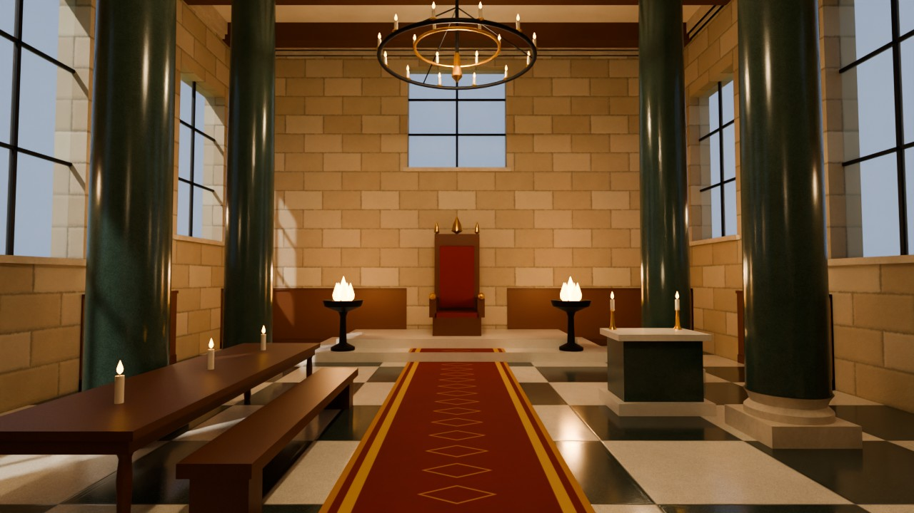
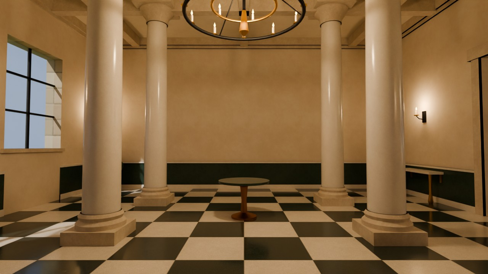
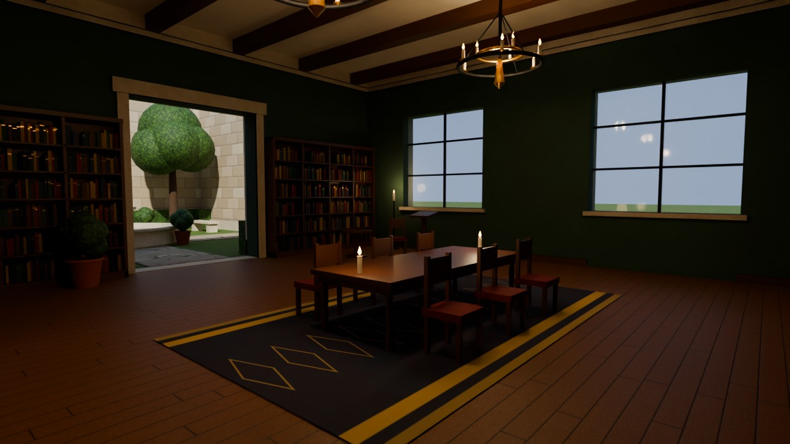
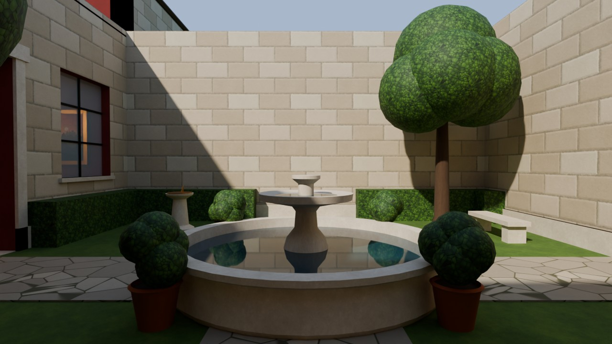
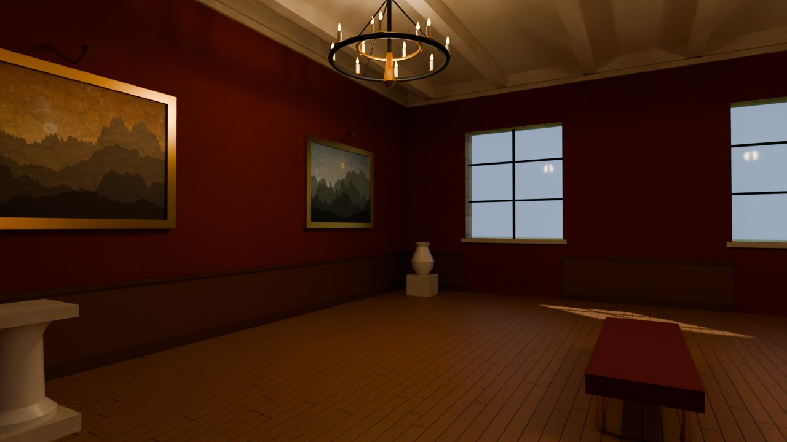
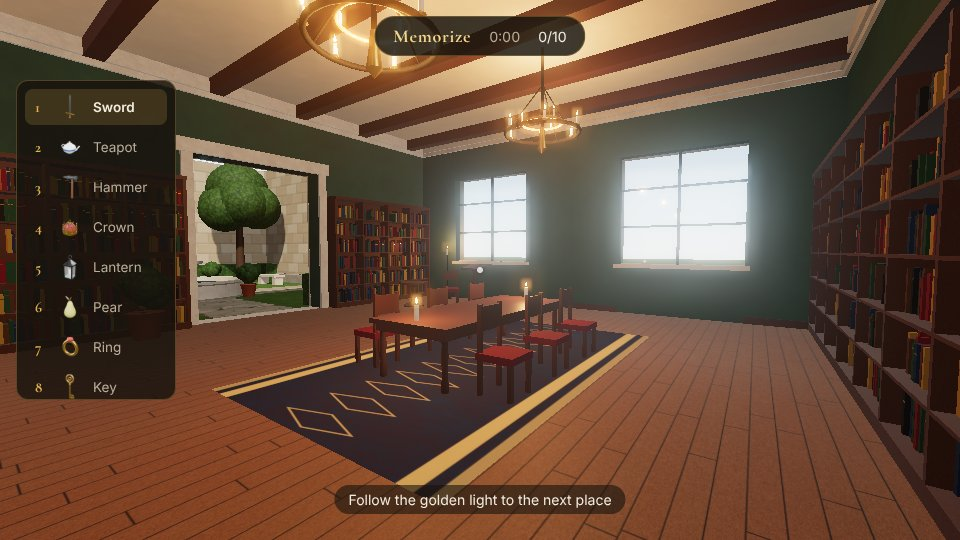
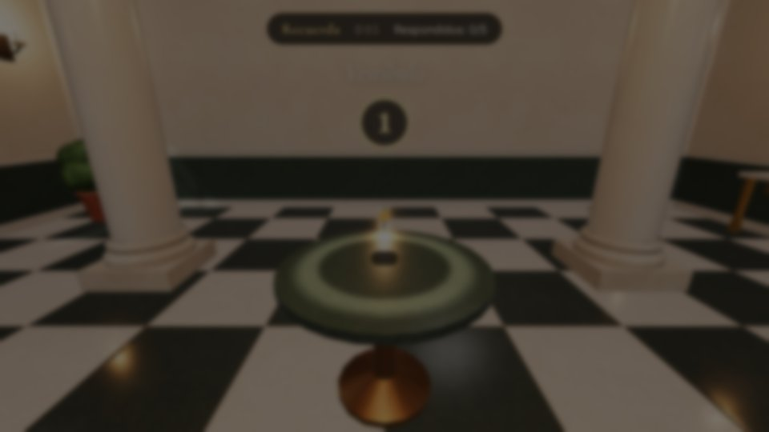

<p align="center">
  
</p>

<h1 align="center">Loci · The Memory Palace</h1>

<p align="center">
  A 3D game about the <b>method of loci</b>: walk through a palace, leave unforgettable images in it and find out how much your mind can hold.
  <br><br>
  <a href="README.md">Español</a> · <b>English</b>
</p>

---

## What is a memory palace?

The method of loci (Latin *locus*, "place") is a memory technique used since ancient Greece by orators such as Cicero. You picture a building you know well and tie each thing you want to remember to a specific place along a route through it. To remember, you simply walk that route again in your mind.

**Loci** turns the technique into a game: the palace really exists, in 3D, and you walk it in first person.

## How to play

1. **Memorize.** You get a list of objects in order. Follow the golden light through the palace and put each object in its place: a pedestal, a reading table, the courtyard fountain, the throne… Each placement shows a vivid, absurd image to help it stick.
2. **Recall.** The objects vanish and you return to the entrance. Walk the palace again and, at each marked place, choose the object you left there.
3. **Results.** See how many you remembered, compare your times with your best score and, if you like, walk the palace to see where everything was.

| Difficulty | Objects | Choices when recalling |
|---|---|---|
| Easy | 5 (one per room) | 10 |
| Normal | 10 | 15 |
| Hard | 15 | 20 |

### Controls

| Key | Action |
|---|---|
| Mouse | Look |
| W A S D / arrows | Walk |
| Shift | Run |
| E / click | Place or choose an object |
| R | Start recalling (once everything is placed) |
| F | Finish (once everything is answered) |
| Esc | Pause |

The game is made for desktop with keyboard and mouse, in Spanish and English.

## The palace

Five connected rooms make up the route, with 15 distinct places (loci), which is exactly what makes the method work:

| | |
|---|---|
|  |  |
| **Vestibule:** marble columns, a checkered floor and a large candle chandelier. | **Library:** shelves full of books, a reading table and a lectern. |
|  |  |
| **Courtyard:** stone fountain, hedges, trees and an open-air sundial. | **Picture gallery:** red walls, gilt-framed paintings and pedestals. |

The route ends in the **Throne hall** (header image), with green marble columns, banners, braziers and the throne on its dais.

*(Images rendered with Blender Cycles from the same models the game uses.)*

### Gameplay screenshots

| | |
|---|---|
|  |  |

## How it is made

All 3D content is **generated from code with Blender**: there are no third-party models or textures.

```
blender/
  lib/textures.py     procedural, tileable PBR textures (marble, wood, stone, grass…)
  lib/geo.py          geometry helpers (boxes, lathes, tubes, prisms) with normals and UVs
  lib/materials.py    glTF-friendly Principled BSDF materials
  build_palace.py     models the palace  -> palace.glb + palace.json (loci, lights, colliders)
  build_items.py      models the 20 objects -> items.glb + Cycles-rendered thumbnails
  render_views.py     Cycles renders of the rooms (the images in this README)
scripts/
  optimize-models.mjs compresses the models for the web (WebP textures + meshopt)
src/                  the game (three.js + Vite)
public/               browser-ready models and thumbnails
```

- **Modeling:** Blender 5 (tested with 5.2), run headless from Python.
- **Game engine:** [three.js](https://threejs.org) with physical lighting, shadows, atmospheric sky, ambient occlusion (GTAO) and bloom.
- **Compression:** [glTF Transform](https://gltf-transform.dev) (the palace goes from 14 MB to ~4 MB).

## Running locally

Requires [Node.js](https://nodejs.org) 20 or newer.

```bash
npm install
npm run dev        # dev server at http://localhost:5173
npm run build      # production build in dist/
```

The generated models are already in `public/`, so you do not need Blender to play.

### Regenerating the models with Blender

With Blender installed:

```bash
blender -b -P blender/build_palace.py
blender -b -P blender/build_items.py
npm run assets:optimize
```

Or with the `bpy` Python module (Python 3.13):

```bash
python -m venv .venv && source .venv/bin/activate
pip install bpy
npm run assets      # palace + objects + optimization
```

To render the rooms with Cycles: `python blender/render_views.py docs/renders 1280 64`.

## Publishing on GitHub Pages

The repository includes a workflow (`.github/workflows/deploy.yml`) that builds and publishes the game on every push to `main`. Enable it once under **Settings → Pages → Build and deployment → Source: GitHub Actions**.

## Ideas for the future

- "Your own list" mode: enter your own words, dates or vocabulary to study.
- Ambient sound (fountain, fire, footsteps) and music.
- Touch controls for phones and tablets.
- More rooms and different palaces.
