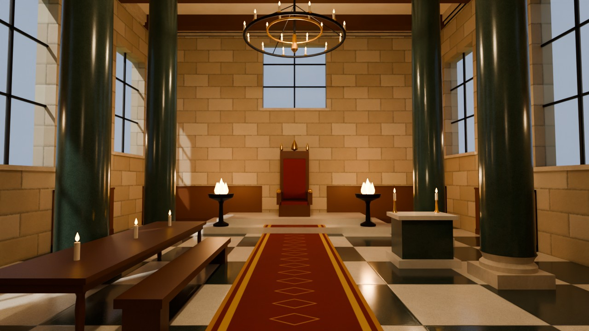
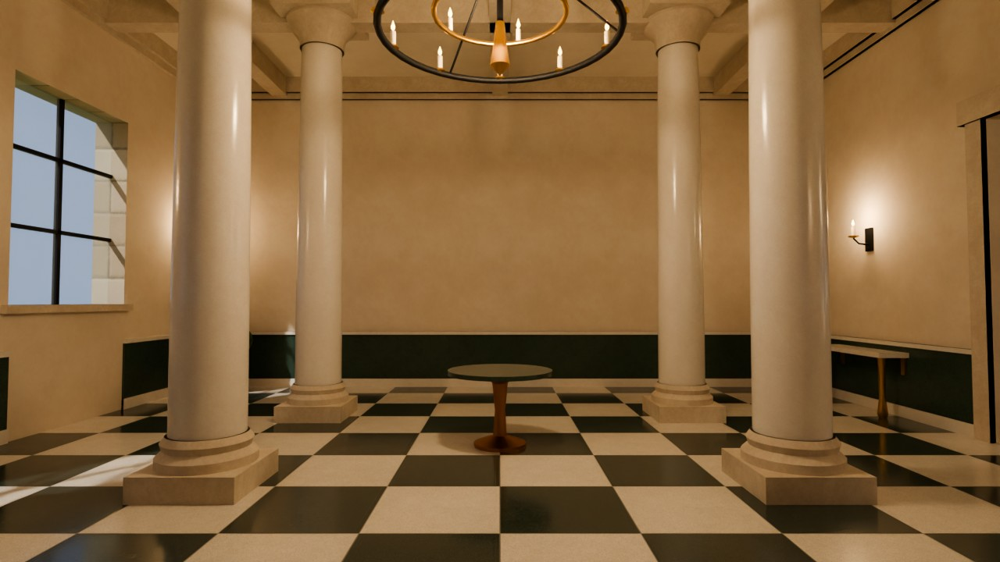
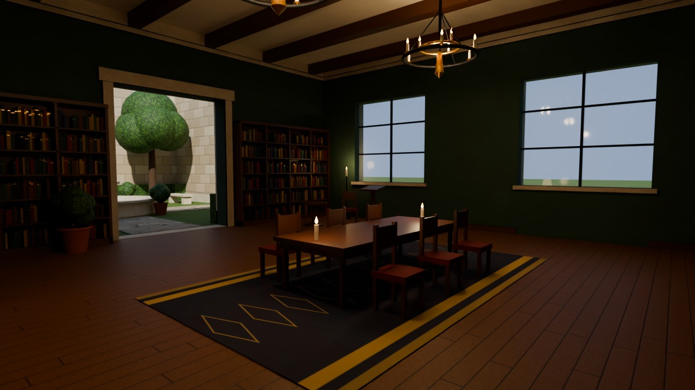
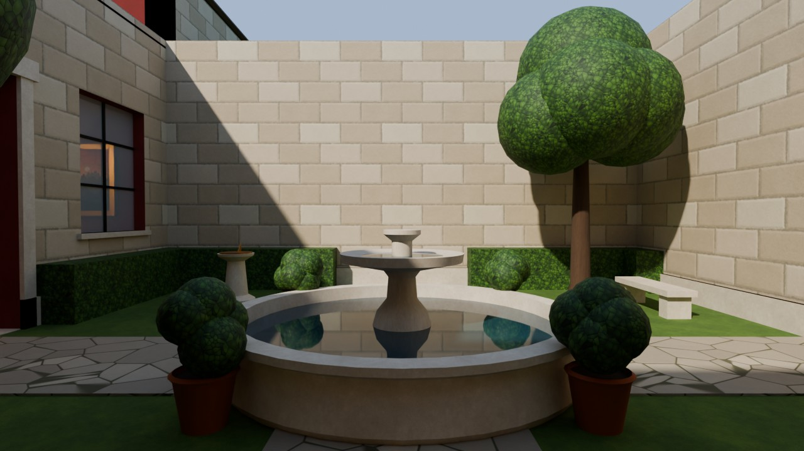
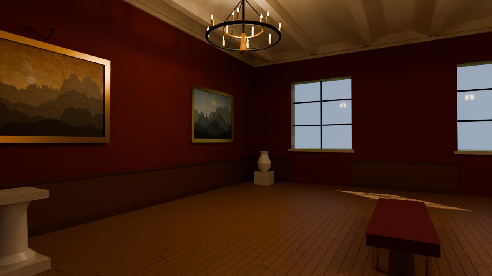
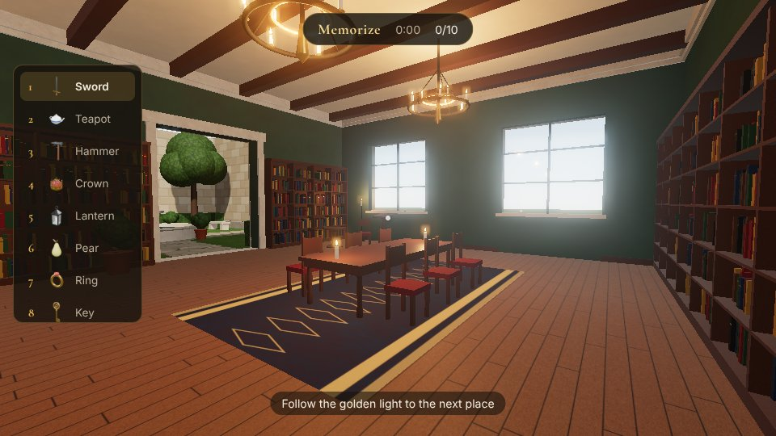
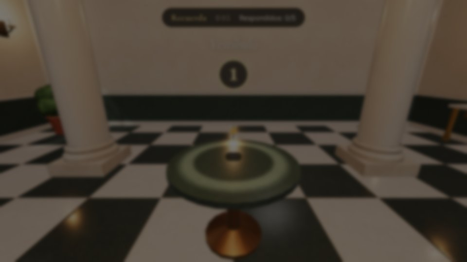

<p align="center">
  
</p>

<h1 align="center">Loci · El Palacio de la Memoria</h1>

<p align="center">
  Un juego en 3D sobre el <b>método de los loci</b>: recorre un palacio, deja en él imágenes imposibles de olvidar y descubre cuánto puede recordar tu mente.
  <br><br>
  <b>Español</b> · <a href="README.en.md">English</a>
</p>

---

## ¿Qué es el palacio de la memoria?

El método de los loci (del latín *locus*, "lugar") es una técnica de memorización usada desde la antigua Grecia por oradores como Cicerón. Consiste en imaginar un edificio que conoces bien y asociar cada cosa que quieres recordar a un lugar concreto de su recorrido. Para recordar, basta con volver a recorrerlo mentalmente.

**Loci** convierte la técnica en un juego: el palacio existe de verdad, en 3D, y tú lo recorres en primera persona.

## Cómo se juega

1. **Memoriza.** Recibes una lista de objetos en orden. Sigue la luz dorada por el palacio y coloca cada objeto en su lugar: un pedestal, una mesa de lectura, la fuente del patio, el trono… Al colocarlo aparece una imagen vívida y absurda que te ayuda a fijarlo.
2. **Recuerda.** Los objetos desaparecen y vuelves a la entrada. Recorre el palacio otra vez y, en cada lugar marcado, elige qué objeto dejaste allí.
3. **Resultados.** Comprueba cuántos has recordado, compara tus tiempos con tu mejor marca y, si quieres, pasea por el palacio viendo dónde estaba cada cosa.

| Dificultad | Objetos | Opciones al recordar |
|---|---|---|
| Fácil | 5 (uno por sala) | 10 |
| Normal | 10 | 15 |
| Difícil | 15 | 20 |

### Controles

| Tecla | Acción |
|---|---|
| Ratón | Mirar |
| W A S D / flechas | Caminar |
| Mayús | Correr |
| E / clic | Colocar o elegir objeto |
| R | Empezar a recordar (cuando todo está colocado) |
| F | Terminar (cuando has respondido todo) |
| Esc | Pausa |

El juego está pensado para ordenador con teclado y ratón. Está disponible en español e inglés.

## El palacio

Cinco salas encadenadas forman el recorrido, con 15 lugares (loci) distintos entre sí, que es justo lo que hace que el método funcione:

| | |
|---|---|
|  |  |
| **Vestíbulo:** columnas de mármol, suelo ajedrezado y una gran lámpara de velas. | **Biblioteca:** estanterías llenas de libros, mesa de lectura y atril. |
|  |  |
| **Patio:** fuente de piedra, setos, árboles y un reloj de sol al aire libre. | **Galería de pinturas:** paredes rojas, cuadros con marco dorado y pedestales. |

El recorrido termina en el **Salón del trono** (imagen de cabecera), con columnas de mármol verde, estandartes, braseros y el trono sobre su estrado.

*(Imágenes renderizadas con Blender Cycles a partir de los mismos modelos que usa el juego.)*

### Capturas del juego

| | |
|---|---|
|  |  |

## Cómo está hecho

Todo el contenido 3D se genera **por código con Blender**: no hay modelos ni texturas descargados de terceros.

```
blender/
  lib/textures.py     texturas PBR procedurales y repetibles (mármol, madera, piedra, césped…)
  lib/geo.py          utilidades de geometría (cajas, tornos, tubos, prismas) con normales y UV
  lib/materials.py    materiales Principled BSDF compatibles con glTF
  build_palace.py     modela el palacio  -> palace.glb + palace.json (loci, luces, colisiones)
  build_items.py      modela los 20 objetos -> items.glb + miniaturas renderizadas con Cycles
  render_views.py     renders de las salas con Cycles (las imágenes de este README)
scripts/
  optimize-models.mjs comprime los modelos para la web (texturas WebP + meshopt)
src/                  el juego (three.js + Vite)
public/               modelos y miniaturas listos para el navegador
```

- **Modelado:** Blender 5 (probado con 5.2), ejecutado sin interfaz desde Python.
- **Motor del juego:** [three.js](https://threejs.org) con iluminación física, sombras, cielo atmosférico, oclusión ambiental (GTAO) y bloom.
- **Compresión:** [glTF Transform](https://gltf-transform.dev) (el palacio pasa de 14 MB a ~4 MB).

## Ejecutar en local

Requisitos: [Node.js](https://nodejs.org) 20 o superior.

```bash
npm install
npm run dev        # servidor de desarrollo en http://localhost:5173
npm run build      # versión de producción en dist/
```

Los modelos ya generados están incluidos en `public/`, así que no necesitas Blender para jugar.

### Regenerar los modelos con Blender

Con Blender instalado:

```bash
blender -b -P blender/build_palace.py
blender -b -P blender/build_items.py
npm run assets:optimize
```

O con el módulo `bpy` de Python (Python 3.13):

```bash
python -m venv .venv && source .venv/bin/activate
pip install bpy
npm run assets      # palacio + objetos + optimización
```

Para renderizar las salas con Cycles: `python blender/render_views.py docs/renders 1280 64`.

## Publicar en GitHub Pages

El repositorio incluye un flujo de trabajo (`.github/workflows/deploy.yml`) que compila y publica el juego en cada push a `main`. Solo hay que activarlo una vez en **Settings → Pages → Build and deployment → Source: GitHub Actions**.

## Ideas para el futuro

- Modo "tu propia lista": introducir palabras, fechas o vocabulario propio para estudiar.
- Sonido ambiental (fuente, chimenea, pasos) y música.
- Controles táctiles para móvil y tableta.
- Más salas y palacios distintos.
